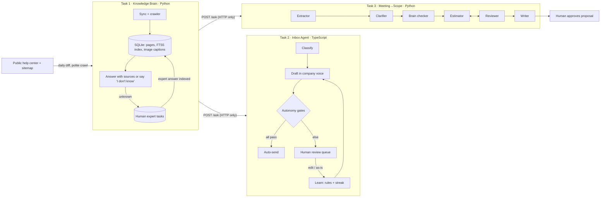

# DESIGN

## 1. The problem, in plain words
Small software businesses pay for the *slow part around the code*: knowing the product, answering every email fast and correctly, and turning client meetings into a priced scope. AI made the code cheap, so the business must do 10–20× more work for the same people. This project automates the slow part with **one shared memory (Task 1)** that two agents (Tasks 2 and 3) lean on.

## 2. How the three tasks connect

The Brain's only public surface is `/ask`, `/search`, `/tasks`, `/sync`, `/health`. Tasks 2 and 3 are written in different languages precisely so they *cannot* share code with Task 1.

## 3. Features chosen and why
**Task 1 – Knowledge Brain**
- *Polite first read*: global rate limit (1 request/s), 2 workers, exponential backoff, `Retry-After` honoured, a **persistent queue** so stopping halfway resumes instead of restarting. Why: hammering a client's help center is the fastest way to get blocked.
- *Daily freshness*: compare sitemap to stored pages. New → fetch. `lastmod` changed → re-fetch, and skip re-indexing if the text hash is identical. Gone from sitemap or 404/410 → chunks deleted, so removed articles **cannot** appear in answers. Weekly `deep=true` re-fetches everything for sites with unreliable `lastmod`.
- *Screenshots*: each content image is captioned by Claude vision (menu names, button labels, values) and indexed beside its article. Captions are cached by image URL so daily runs don't re-pay.
- *Honest answers*: answer only from retrieved text; citations are checked against what was actually retrieved (hallucinated URLs dropped); weak evidence → "I don't know" **and** a task for a human. The expert's reply is indexed as a first-class source, so the *next* person with that question gets an answer without a human. Why: this is the "brain gets better every week from the people who use it" requirement.
- *Retrieval*: SQLite FTS5 (BM25, stemming) plus Claude-written keyword expansion. Why not a vector DB: Anthropic has no embeddings endpoint, the corpus is "hundreds" of articles, and BM25+expansion is cheap, transparent and debuggable. **Known weakness:** pure vocabulary gaps ("billed twice" vs "billing error") rely on the expansion step.

**Task 2 – Inbox Agent**
- *Draft, don't just reply*: classify (8 categories + risk) → ask the Brain → draft using only returned facts, with a self-check flag `unsupportedClaims`.
- *Learning from humans*: every edit is distilled into **one general rule** (or discarded as a one-off). A rule is adopted only if replaying the last 6 human-approved examples with it scores ≥ without it (word-level similarity to the human's final text). Playbooks are versioned and can be rolled back.
- *Earning autonomy* (our definitions, as the brief asks): "same kind" = same classifier category. "Without changing" = identical after ignoring case/spacing/punctuation — **one changed number is an edit**. 20 unchanged in a row → category may auto-send. Even then every gate must pass: not refund/complaint/quote, low risk, Brain answered, no unsupported claims, confidence ≥ 0.8, no injection signal. Every 5th auto-send is also shown to a human (**audit**). An edited audit, or a customer complaint, **revokes** autonomy and zeroes the streak; the log says why.
- *Safety*: email text is treated as data; injection patterns force high risk in code (not just in the prompt); Brain outage → human review instead of a crash.
- 51 hand-written emails in `data/emails.json`, including injection, Spanish, one-word, mixed-intent, angry mail, and a GitHub integration request.

**Task 3 – Meeting → Scope**
Five agents, one job each, typed hand-offs:
1. **Extractor** transcript → requirements (client's exact quote kept; `vague` flag; explicit out-of-scope).
2. **Clarifier** the senior consultant's questions (max 6) on vague/volume/integration gaps.
3. **Brain checker** asks Task 1: "can an existing setting solve this?" in parallel. Findings carry source URLs.
4. **Estimator** hour *ranges* per task; `existing_setting` basis only if the Brain confirmed one.
5. **Reviewer** deterministic checks (every requirement covered, no fake "setting" claims, high ≥ low) + a skeptical second model. One fix loop; unresolved issues are **shown, not hidden**.
6. **Writer** plain-English proposal. Status stays `draft` until a human calls `/approve`.
Follow-up meetings run an **Updater** (add/change/remove/confirm against existing ids) and re-estimate *only touched requirements*; the proposal gets a "What changed" section. Real hours fed to `/actuals` become calibration notes in the Estimator's prompt.

## 4. Features dropped, and why
- Vector DB / embeddings: see above; revisit if the corpus passes ~5,000 articles.
- Auth beyond a shared API key, multi-tenant isolation, real SMTP/Gmail: out of 4-day scope. Mail goes to an outbox interface.
- UI: APIs + OpenAPI docs only. The review queue is an endpoint, not a screen.
- Real-time sync via webhooks: help centers rarely offer them; daily diff is simpler and polite.

## 5. Model choices
Haiku-class for extraction, classification, captions, writing (cheap, structured). Sonnet-class for answering, estimating, reviewing (judgment). These are **defaults, set by env vars**, and are only "decided" once `EVALS.md` shows the numbers (see that file).

## 6. What breaks / limits (honest list)
- The crawler's HTML selectors (breadcrumb → category/folder) were written from common help-center markup and tested against a local fixture; **not yet run against the live Brilliant Directories site** (my build sandbox couldn't reach it). First live run may need selector tweaks in `extract_page`.
- Lexical retrieval misses pure synonym gaps.
- Autonomy streak is per category, not per sub-topic: a category with very different questions can earn trust on easy ones. Audits are the safeguard.
- Estimates are only as good as the Brain's coverage; with no article found, the Estimator assumes custom work (safe but pricier).
- The mock model used in tests is keyword-based; passing tests prove plumbing and safety logic, not language quality.

## 7. What I would build next
Embeddings via a second retrieval path; per-topic autonomy; a small review UI; shadow-mode evaluation (run the agent silently for a week and compare to humans); hidden-set regression suite run in CI.
